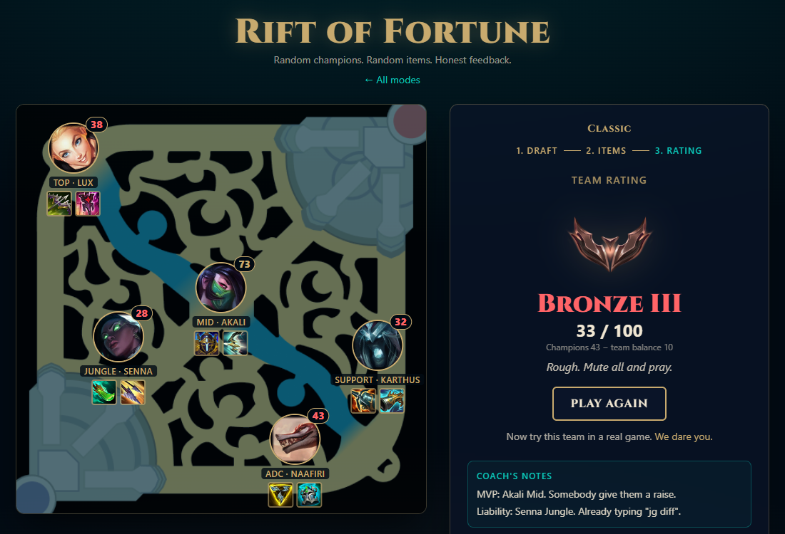
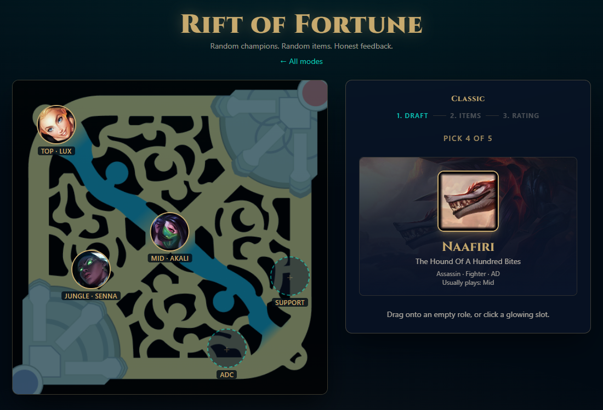
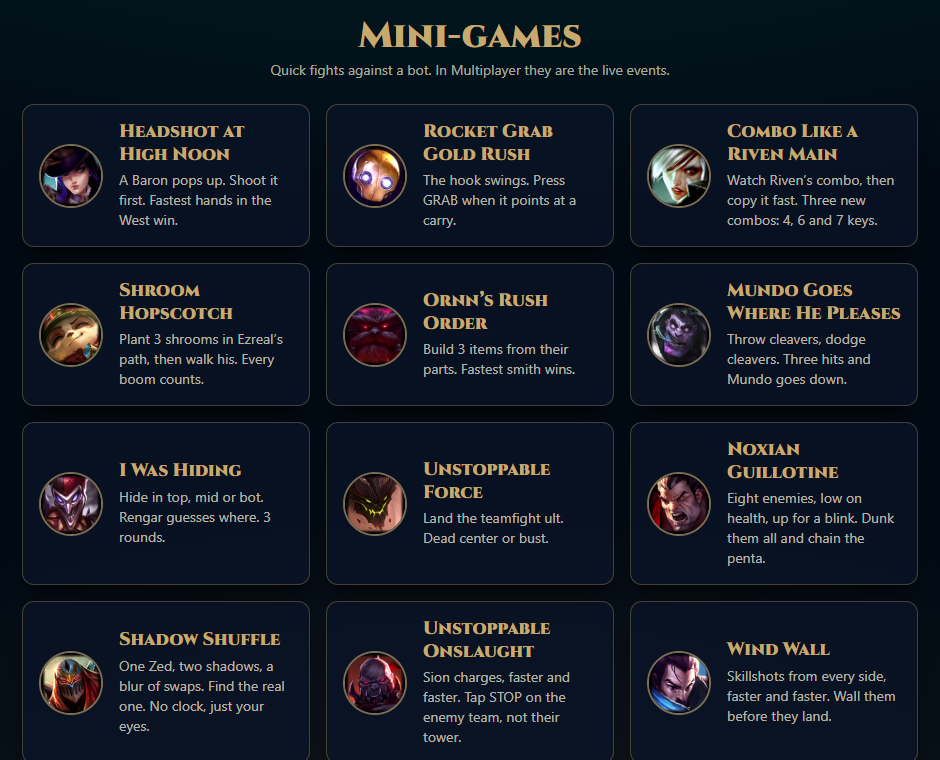

<div align="center">

# Rift of Fortune

**Random champions. Random items. Honest feedback.**

Roll random League of Legends champions, put them in roles on Summoner's Rift,<br>
hand out random items and find out if your team is Challenger or Iron IV.

### [▶ Play now at rift-of-fortune.vercel.app](https://rift-of-fortune.vercel.app)



</div>

## Game Modes

| | |
| --- | --- |
| **Classic** | Roll 5 champions, place them on the map, hand out 10 items, get ranked. 3 rerolls each. |
| **Daily Rift** | Same team for everyone, one try a day. Share your result and see how many players you beat. |
| **Multiplayer** | Send a friend a link. Draft against each other, or let 5 lanes fight it out in mini-games. |
| **Mini-games** | 14 quick champion games against a bot, from Blitzcrank hooks to a Baron smite duel. |

<p align="center">
  
  
</p>

## Tech Stack


- **Pure game logic.** Drafting, scoring, the match simulation and the multiplayer rules are plain TypeScript in [`src/game/`](src/game), separate from React and covered by 657 Vitest tests.
- **Real-time multiplayer without a game server.** Lobbies use Supabase Realtime (Broadcast + Presence) and work from a shared link or a 5-character code.
- **A data pipeline.** A Node script pulls Riot Data Dragon and Meraki Analytics data and trims it into typed JSON, so the game makes no live API calls for game data.
- **Calibrated with data.** The rank cut-offs come from simulating thousands of random teams. The Daily uses a date-seeded random generator, so every player gets the same team.
- **Polish.** Drag and drop with dnd-kit, Framer Motion animations, sound, mobile layouts and 14 hand-built mini-games.

## How Scoring Works

Each champion gets a score from **role fit** (main role, off-role or disaster) and **item fit** (do the stats suit the champion?). The team score is the average, minus balance penalties like no frontline, all one damage type or no marksman in bot lane. The score maps to a rank from Iron IV to Challenger. All numbers live in [`src/game/scoring/config.ts`](src/game/scoring/config.ts).

## Run It Locally

Requires Node.js 22.18 or newer.

```sh
npm install
npm run dev
```

`npm run build` · `npm run test` · `npm run lint` · `npm run data` (fetch the latest champion and item data)

Daily stats and Multiplayer use a free [Supabase](https://supabase.com) project. The game works without it. See [docs/launch-setup.md](docs/launch-setup.md) for setup and [SPEC.md](SPEC.md) for the full design.

**Data from** Riot's [Data Dragon](https://developer.riotgames.com/docs/lol#data-dragon), [Meraki Analytics](https://github.com/meraki-analytics/lolstaticdata), [CommunityDragon](https://www.communitydragon.org/) and the [League of Legends Wiki](https://wiki.leagueoflegends.com/) (CC BY-SA).

## Disclaimer

Rift of Fortune isn't endorsed by Riot Games and doesn't reflect the views or opinions of Riot Games or anyone officially involved in producing or managing Riot Games properties. Riot Games, and all associated properties are trademarks or registered trademarks of Riot Games, Inc.
